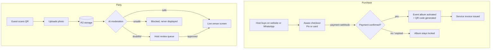

# Toaki.vip — Engineering & QA Case Study

> Collaborative photo album for parties: guests scan a QR code, upload photos from their phones, and the best moments show up live on the venue screen.

**Status:** first live-event test completed (October 2026).
**Role:** Founder, Tech Lead and QA.
**Stack:** Cloudflare Workers (API), D1 (database), R2 (media storage), Asaas (Pix and card), WhatsApp Cloud API (sales agent), AI image moderation.

---

## Main flows

## Risk-based test strategy

Children's parties are the core market, so the highest risks are about **what reaches the big screen** and **who can see the album**.

| Risk | Impact | How it is tested |
|---|---|---|
| Inappropriate photo shown on the venue screen | Critical | Moderation runs **before** display; doubtful results default to the host queue, never to the screen; test set of borderline images |
| Album accessible to strangers | Critical | Unguessable album tokens; access tests with expired, altered and other-event tokens |
| Album unlocked without payment | High | Webhook-only unlock; tests for pending, expired and refunded charges; duplicate webhook does nothing |
| Guest upload fails on weak venue Wi-Fi | High | Large files, slow 3G throttling in DevTools, retry after connection drop |
| One event sees another event's photos | High | Event ID scoping on every D1 query and R2 key; cross-event access tests |
| Wrong price or charge amount | Medium | Amount computed server-side; tampering with client payload must not change the charge |

## Sample test cases

| ID | Scenario | Expected |
|---|---|---|
| TK-01 | Pix charge paid → webhook received | Album active, QR available to host |
| TK-02 | Same webhook delivered twice | One activation, no duplicate invoice |
| TK-03 | Pix charge expires unpaid | Album stays locked; host can generate a new charge |
| TK-04 | Guest opens album URL with a modified token | Access denied, no metadata leaked |
| TK-05 | Photo flagged as doubtful | Appears only in host queue, never on screen |
| TK-06 | Host rejects a queued photo | Photo never displayed; removed from the album |
| TK-07 | Upload of a 15 MB image on throttled network | Progress shown; clear error and retry on failure |
| TK-08 | Album accessed after retention period | Not available |

## LGPD

- Photos are personal data, often of minors: access only through the event's link, no public indexing
- Moderation before exhibition, human decision for edge cases
- Deletion on request

---
*Part of [Marcio Viana Junior's portfolio](https://github.com/msvjr).*
